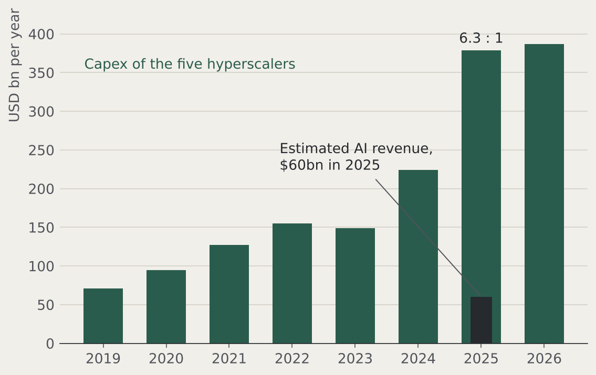
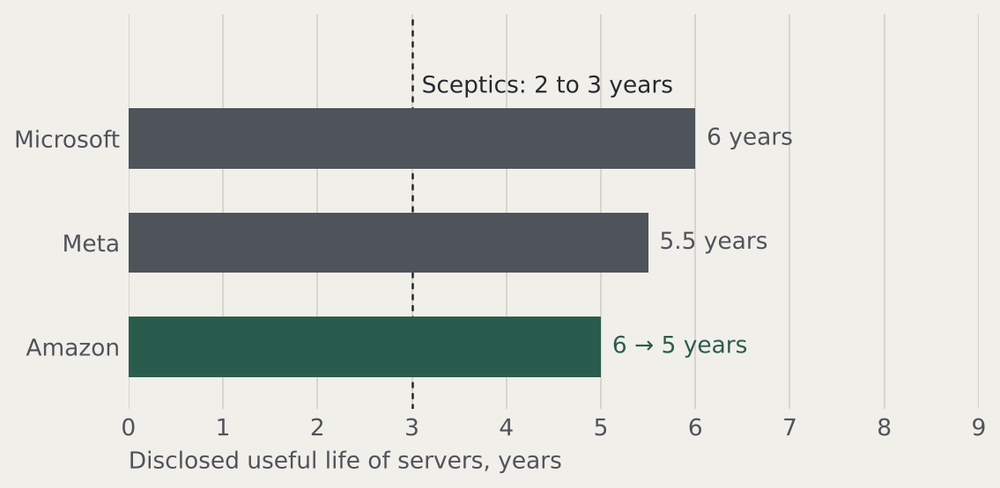
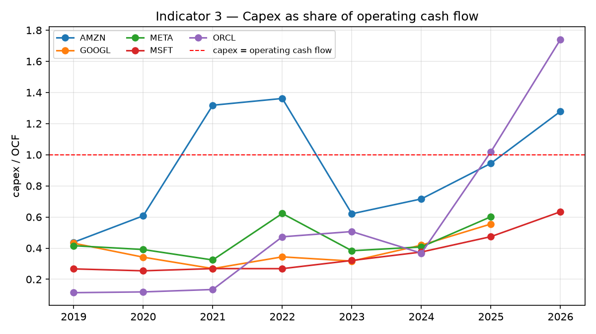
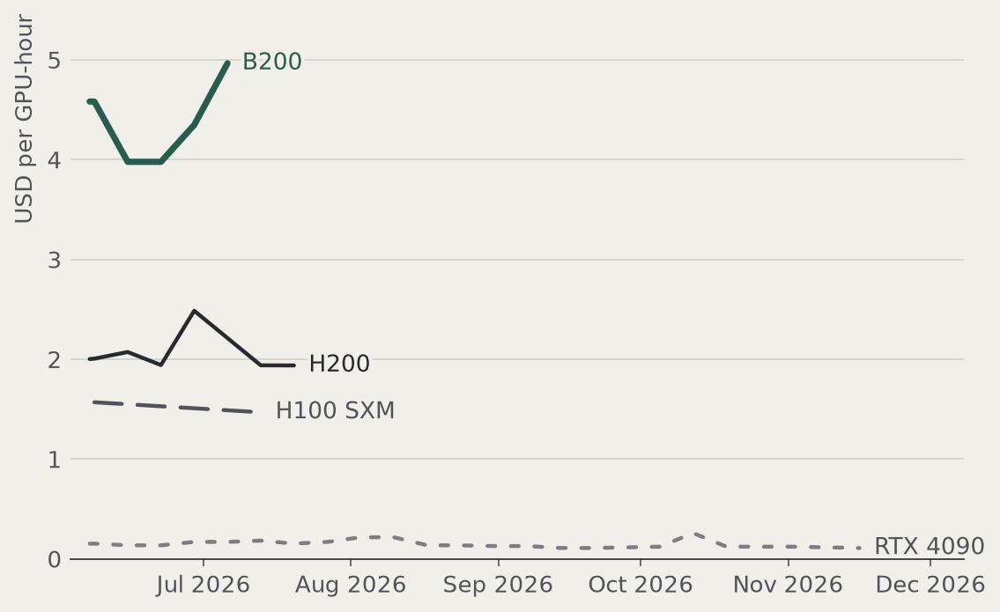
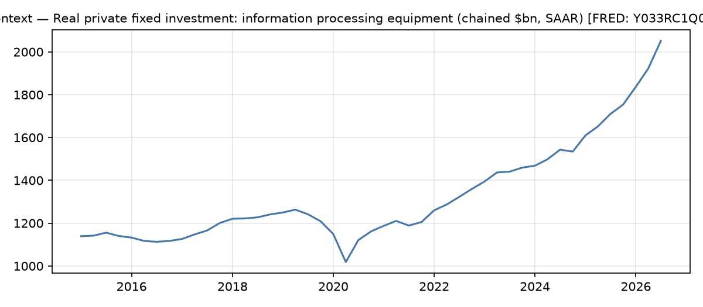
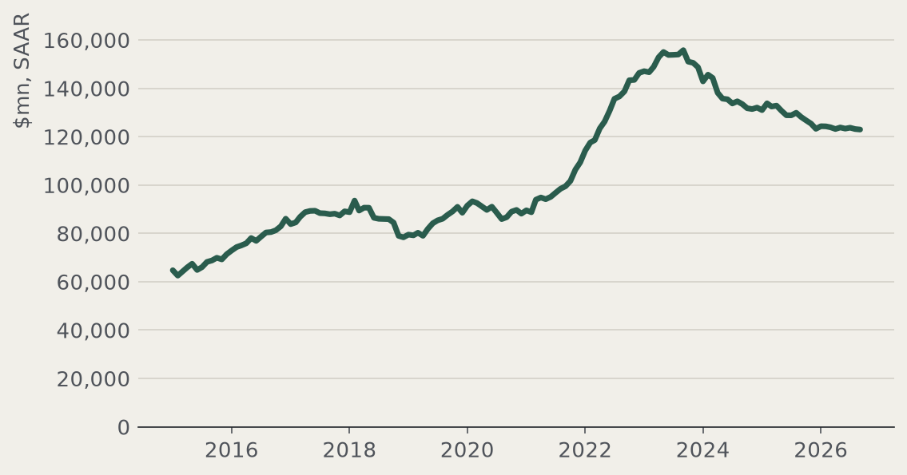

# AI boom indicators

*Last refresh: 2026-11-02*

Four falsifiable indicators of whether the AI investment boom is being
financed in a way that can absorb disappointment. Companion to chapter 9
of [The Price of Thinking](https://priceofthinking.com/chapters/the-boom/).
Data: SEC EDGAR (XBRL + 10-K text), FRED, vast.ai marketplace. Updated
automatically; every number traceable to a public primary source.

**In 2025, hyperscaler capex ran at 6.3 times estimated AI revenue.** USD bn per year, calendar years; ratio of capex to AI revenue labelled.

*Source: SEC EDGAR XBRL company facts (Microsoft, Alphabet, Amazon, Meta, Oracle; payments for property, plant and equipment); AI revenue is a single curated estimate, Derek Thompson, 2025.*

**Amazon shortened its server life from 6 to 5 years; the others hold at 5.5 years or more.** Disclosed useful life of servers in the latest Form 10-K, years; green marks a shortened life.

*Source: Latest Form 10-K of each company via SEC EDGAR, property and equipment note; the extracted sentence and filing URL are kept in the repository. Alphabet and Oracle disclose no figure.*

**Oracle's capex ran at 1.7 times its operating cash flow in 2026.** Ratio of annual capex to net cash from operating activities; above the dotted line, capex exceeds operating cash flow.

*Source: SEC EDGAR XBRL company facts; fiscal years; the latest year may be incomplete.*

**B200 rentals cost $4.96 per GPU-hour in July, against $4.58 in June.** Median asking price of rentable offers, USD per GPU-hour, weekly snapshots.

*Source: vast.ai public marketplace. Offers for the newest chips are few and some weeks have none, so a line stops where no offers were listed.*

**Real investment in information-processing equipment stood 65% above its 2019 level in Q3 2026.** Real private fixed investment, information processing equipment, chained dollars, billions, seasonally adjusted annual rate.

*Source: FRED, Federal Reserve Bank of St. Louis, series Y033RC1Q027SBEA.*

**Spending on communication construction stood 40% above its 2019 level in September 2026.** Total construction spending, communication, millions of dollars, seasonally adjusted annual rate.

*Source: FRED, Federal Reserve Bank of St. Louis, series TLCOMCONS.*
